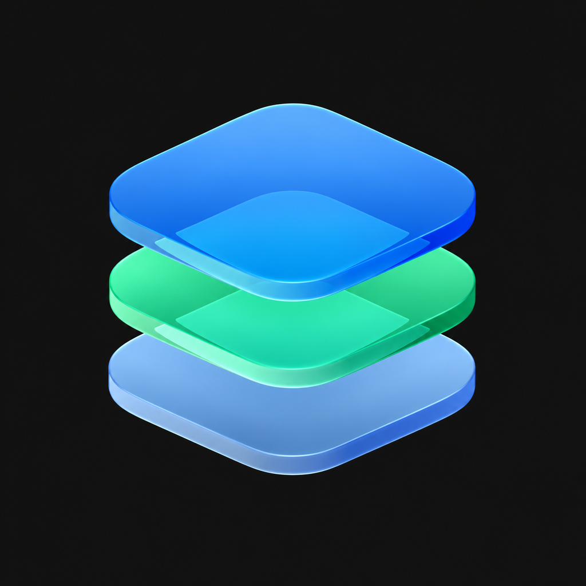

# Strata 4.0 (Simplified Chinese build)

**English** | [简体中文](README.zh-CN.md)

A customizable launcher built on [LiveContainer](https://github.com/LiveContainer/LiveContainer), with three interfaces and bundled SideStore support.

<p align="center"></p>

## Three interfaces

- **iOS Home Screen:** portrait layout, custom icons and names, static/video wallpapers, widgets, folders, scrubbable page dots, dock favorites, search and a categorized App Library.
- **Cinematic:** landscape console-style app rail, artwork, categories, adjustable Play controls and controller navigation.
- **Big Picture:** landscape library with independent portrait artwork, categories, layout sizing and controller navigation.

Artwork, categories and hidden-app choices are independent between interfaces. Imported artwork and wallpapers are available in Files → On My iPhone → Strata → Artwork.

## What's new in 2.0

- Built-in JIT preparation using a device pairing record and LocalDevVPN, plus automatic/Universal/imported per-app script choices.
- Integrated RAM capability account setup and actual host/guest memory reports. Entitlements remain subject to Apple's signing profiles and iOS limits.
- One three-finger app switcher inside the launcher and guests, showing running apps and optional pins. Open, restore, minimize or close supported guests without a permanent floating arrow.
- Native paged scrolling, continuous dock/backdrop transitions and Home-only page dots with scrubbing.
- Drag-to-create folders, drag apps out, dissolve folders while retaining apps, and hold blank Home space to edit.
- Launch with Metal HUD for supported Metal apps.

## What's new in 4.0 (synced from upstream)

This build now tracks [huzaifahshahid71-ops/Strata](https://github.com/huzaifahshahid71-ops/Strata) 4.0:

- **Six interfaces**: the original iOS Home Screen, Cinematic and Big Picture plus Switchboard, Shelf and Arcade, all controller navigable.
- **Runtime manager**: guest file browsing, portable backups (create, verify, restore) and signing identity / Keychain migration in one place.
- **Automatic refresh**: schedule SideStore refreshes by interval, get reminded when they fall due, and optionally drive LocalDevVPN through the Set VPN Shortcut.
- **Frame generation (experimental)**: 2x/3x/4x presented frames with a measurement panel.
- **Storage index**: rescan guest containers and recompute their footprint on demand.
- **Memory overlay**: live usage and limits for Strata, each app and each helper process.
- **HostJIT in-process**: the existing iOS launch, guest-extension JIT and multitasking paths stay as fallbacks.

## Download and install

Get **Strata-2.0+SideStore.ipa** from [Releases](https://github.com/huzaifahshahid71-ops/Strata/releases/tag/v2.0.0). Sign and install with SideStore. When updating a compatible combined installation, **keep the current app and choose Keep App Extensions**, using the same account and identity to preserve data. Back up important guest data first.

Strata 2.0 is the product release name; this build uses the LiveContainer **3.8.11** base and development revision **25**. The underlying bundle version/identity are retained for update compatibility. The IPA does not contain personal signing credentials or pairing records.

## Chinese build (v11 → v14)

The `zh-hans` branch ships a fully localized Simplified Chinese UI and README. v11 does two things on top of the rolled-back v7 baseline:

**Merges the LiveContainer upstream update of 2026-11-08 (`9d6ea09b05`)**: built-in JIT enablers / RAM donors / helper processes and guest app extension support (`NSExtension+GuestHooks.m`, `LCPrepareGuestExtension`, `patchGuestExtensions`), the `LCAppModel.copy(fromApp:toAppInfo:)` refactor, and a new "Helper Process Support" toggle in per-app settings. The merge is three-way, so all Strata LiveBoard and Game Mode customizations are preserved; the upstream reference to `fixBackgroundTaskIdentifiers` was removed because v7 has no such property.

**Fixes certificate and tweak-module import**:

- Declares the `com.kdt.livecontainer.p12` UTI (`p12` / `pfx` / `pkcs12`) and a Signing Certificate document type. Certificates can be opened with Strata straight from Files, and file URLs route to Settings.
- Certificate import now uses security-scoped access, automatically retries with an empty password, accepts both `cert=` and `data=` deep-link parameters, and writes `LCAppGroupID` on success.
- Tweak import uses `copyItem` with security-scoped access instead of `moveItem`, so read-only sources from Files / share sheets work.
- `strataPresentSafely` works around the SwiftUI `.alert` dismissal race, so the document picker and password prompt no longer fail silently; all `UTType` force unwraps were removed.

The bundle version is **3.8.19**, higher than every previous build, so it can be installed over the top without uninstalling. This build contains **no SideInstaller**; the built-in store entry remains the original SideStore. **1332** Chinese strings are shipped.

### v12: floating menu did not appear even when enabled

The bundled Orbit / LCFloatingMenu is bumped to upstream **1.0.36** (8pt larger close-button hit area), and the bootstrap gate is fixed at the root:

- It no longer requires a non-nil `guestAppInfo` and no longer excludes `isLiveProcess`. Strata 2.0 multitask guests themselves run inside `LiveProcess.appex`, so the old check excluded every guest and the toggle did nothing.
- Guest detection now compares whether `mainBundle` has been rewritten to the guest bundle; the Strata UI and built-in SideStore still never show the bead.
- The switch is resolved from the env var, the App Group defaults, and the host defaults in turn; when none of them has a value it defaults to on and writes the value back, so a switch stored in the wrong suite can no longer be read back as "off".
- Bootstrap attempts now run immediately, at 0.6s, 2s, 5s, and again on foreground / scene activation, so enabling the switch while a guest is running takes effect without relaunching.
- A status row plus "Copy diagnostics" is added under the floating menu toggle; each guest writes its decision into the App Group so failures are visible.
- Cleanup: removed the unused `LCOrbitHost.isSupportedGuest` (its logic contradicted LiveProcess guests), removed `GuestInfo()` and a redundant `objc/message` import, and merged the duplicated host/guest/SideStore checks in `installIfPossible` into the single gate in `LCOrbitCore`.

The bundle version is **3.8.20**, and **1337** Chinese strings are shipped.

### v13: landscape-right misalignment and black bars fixed

The plugin shipped a global "orientation enforcement" layer; it is removed entirely, leaving only "keep screen awake":

- **No more window frame / bounds rewriting.** On every `layoutSubviews` and orientation change it forced every window to `(0,0,landscape width,landscape height)`. Since iOS 13 window geometry is owned by `UIWindowScene`, so hard-setting the frame desynchronises the window from the scene coordinate space - in landscape right the content is pushed to one side and a black bar appears on the other.
- **No more global replacement of `supportedInterfaceOrientations` / `__supportedInterfaceOrientations`.** It fought LiveContainer's own per-app orientation lock in `TweakLoader/UIKit+GuestHooks` for the same selector, breaking the lock and force-rotating portrait-only apps into a broken layout.
- **Orientation is declared by the system and the guest app again:** landscape-capable apps rotate normally, portrait-locked apps stay portrait, and `App settings -> Orientation lock` works again.
- The "left landscape adapt" and "ban right landscape" switches in the floating-menu settings are gone (they only patched the layer above); "Keep screen awake" stays.

The bundle version is **3.8.21**, and **1337** Chinese strings are shipped.

### v14: remaining English in LiveBoard, JIT and memory pages

Up to v13 only literal `Text("...")` sites were covered. `Text(ternary)`, `String` variables and array labels **never go through localization**, so plenty of English was left on screen. This release fixes each display path:

- **Ternary expressions** (`Text(a ? "X" : "Y")`, `Label(...)`, `Button(...)`): all now use `"X".loc`. SwiftUI's `Text`/`Label`/`Button` take a plain `String` without localization, which was the main source of English across the three LiveBoard interfaces (Cinematic / Big Picture / Home).
- **`String` assignments and returns**: `LiveBoardMode.title/detail`, `StrataJITScriptMode.title`, `getStoreName()`, and every `errorInfo = "..."`, `status = "..."`, `session.message = "..."`, `throw "..."` now use `.loc`.
- **Array labels**: the console action menu (`["Launch", "App settings", ...][index]`) is localized item by item.
- **Interpolated messages**: switched to `LCStr("key", "fallback", args)` with fixed keys so extracted key names cannot drift (9 new keys: `strata.jit.guestAck`, `strata.memory.*`, ...).
- **ObjC**: the "App controls unavailable / Hide app strip / No open apps" strings in `StrataGuestControls` now use `NSLocalizedString`.
- Three formatted strings (`"%lld apps"`, the clean-data-folder confirmation, and the move-folders completion note) used `.localizeWithFormat()`, whose compiler-extracted keys never matched the fragment and fell back to English; they now use fixed `LCStr` keys.
- **Category chips**: LiveBoard's default categories (Games / Ports / Tools) keep their English keys as data, but the display path now goes through `.loc`, and `Ports` / `Tools` gained translations, so the chip row is fully Chinese.
- Two dead keys (`Other Entitlements`, `Version %@`) with no remaining call site were dropped.
- Chinese strings grow from **1337 to 1452** (fragment 1005 → 1120 entries).

The bundle version is **3.8.23**.

### v16: localizing SideStore itself

The SideStore inside the `+SideStore` package is the official nightly build, converted by `dylibify` into `SideStoreApp.framework`. It ships **no `.lproj` at all** and uses the English copy as the localization key (`NSLocalizedString("Pledge")`, `Text("Provisioning Profiles")`), falling back to `Bundle.main` — which, once injected, is LiveContainer. The main bundle's `zh-Hans` table therefore applies without touching the prebuilt binary.

Scanning `LiveContainer/SideStore` (`LiveContainerSupport`) yielded 1506 UI strings; 828 were missing from the table and are translated here, plus 157 `%lld` variants (SwiftUI derives `%lld`, not `%@`, for integer interpolation). Covered:

- **Accounts and sign-in**: two-factor, Anisette servers, on-device ADI, sign-out confirmation
- **Certificates and profiles**: create/import/revoke, missing private key, the free-account 1-certificate and 7-day limits
- **Devices and App IDs**: device registration, UDID, app groups, capabilities
- **Pairing and tunnels**: pairing files, LocalDevVPN, WireGuard parameters, EMProxy, Minimuxer
- **Sources and apps**: source validation (hash / size / bundle ID), marketplace apps, refresh, the 3-app limit
- **Logs and diagnostics**: per-subsystem verbose logging, raw dumps, exports

Keys stay English so calls that localize by source text, such as `String(formatted:)`, keep working. Bundle version **3.8.24**; Chinese strings grow from **1452 to 2437**.

### v17: making the SideStore translation actually take effect

v16 shipped 828 SideStore strings into the host bundle's `zh-Hans` table, yet the device still showed English. The cause is in `LCBootstrap.m`:

```objc
NSBundle *appBundle = [[NSBundle alloc] initWithPathForMainBundle:bundlePath];  // = Frameworks/SideStoreApp.framework
overwriteMainNSBundle(appBundle);   // replaces NSBundle.mainBundle process-wide
```

When SideStore runs as the built-in guest, `Bundle.main` becomes `SideStoreApp.framework`, and that framework contains **no `.lproj` at all**. Every `NSLocalizedString` and SwiftUI `Text` lookup therefore falls back to the English source text; the host bundle's table is never consulted. This release fixes both halves:

1. **Ship the Chinese table inside the framework.** After injecting `SideStoreApp.framework`, `build_github.sh` copies the host bundle's `zh-Hans.lproj/Localizable.strings` (1452 Strata entries plus 985 SideStore entries) into the framework's `zh-Hans.lproj` **and** `en.lproj`. The second copy is a safety net: whichever localization iOS resolves, the result is Chinese rather than English.
2. **Cover the text baked into storyboards.** The whole Settings screen, the onboarding flow and the tab bar are compiled into nibs (`Settings.storyboardc`, `Authentication.storyboardc`, `Main.storyboardc`) and never hit a localization lookup. `LiveContainer/StrataGuestTextTranslation.m` adds a small lookup layer over `UILabel.setText:`, `UIButton.setTitle:forState:`, `UITabBarItem.setTitle:`, `UINavigationItem.setTitle:`, `UIViewController.setTitle:`, `UITextField.setPlaceholder:` and `UISearchBar.setPlaceholder:`, covering 40+ settings rows, 20+ onboarding sentences, the tab bar and the My Apps screen. It is gated on the main bundle path containing `SideStoreApp.framework`, so the host app and every other guest stay untouched.

Bundle version **3.8.25**.

### v18: pulling the storyboard-baked settings rows into Chinese

v17 got the bundle right, yet the same screenshot still showed "Background Refresh", "Health Check", "View Error Log" and "Storage Explorer" in English while the footnotes below them were Chinese. Two causes:

1. **The gate was frozen by `dispatch_once`.** `LCGuestTextTranslationEnabled()` cached its first result, but `mainBundle` is only swapped to `SideStoreApp.framework` after `main()` runs — and the host's own UI sets labels before that. The very first call therefore cached "not a guest" forever, short-circuiting every hook. That is why v17 replaced exactly nothing.
2. **nib decoding never calls the setters.** Static labels such as `text="Background Refresh"` are restored inside `initWithCoder:` when the compiled nib loads, so a `setText:` hook never fires. The footnotes were Chinese only because `SettingsViewController` assigns them in code via `NSLocalizedString`.

This release:

- The gate now caches only `true`; a `false` result is recomputed on every call.
- All setter hooks stay, plus a **view-tree pass** driven by `UIView.didMoveToWindow` and `UIViewController.viewWillAppear:`. It walks `UILabel` (including `attributedText`), `UIButton` (titles and attributed titles for all four states), `UITextField` / `UISearchBar` placeholders, `UISegmentedControl` segments, and also fixes `title`, `navigationItem.title` and `tabBarItem.title`. Text now resolves through the glossary whether it came from a nib or from code.
- The glossary grows to **106 entries**, adding field names such as `Date`, `Email`, `Name`, `Type`, `Source Name`, `Developer`, `Installed`, `YES`, `NO` and `stable`.

Bundle version **3.8.26**.


### v19: synced with upstream Strata 4.0

`git merge` of upstream `main` (`3221d76`, Release Strata 4.0) into this branch, with the common
ancestor v2.0.0 as the merge base:

- **Both fork-owned pieces survived**: the Orbit multitasking layer (its own `Orbit/` tree, no
  conflict) and the Simplified Chinese localization.
- **Eight conflicts resolved**: the new Switchboard / Shelf / Arcade interfaces in `LiveBoard` keep
  `.loc`; `LiveBoardHomeScreen` takes the upstream tools page; `StrataMemoryCapabilities` takes the
  upstream RAM-bypass wording with `.loc`; `LCAppModel` restores `fixBackgroundTaskIdentifiers`;
  `LCBootstrap` keeps the upstream memory sampler; `Info.plist` is pinned to **4.0.0**.
- **CI stays on this repository's setup**: `runs-on: macos-latest` with Xcode 26.2 (upstream uses a
  self-hosted `xcode-27` label), and the Chinese catalog merge step is preserved.
- **219 new zh-Hans entries** cover the 4.0 surfaces. `StrataToolsPage.Tool` stores `String`, so its
  titles need an explicit `.loc` to hit the catalog.
- One upstream Swift 6 problem fixed: `Task.detached` returning `NSDictionary` is not `Sendable`, the
  closure collapsed to `Void`; the scan now converts to `[[String: String]]` inside the task.

Bundle version **4.0.0**.


## JIT and RAM setup

Import your own pairing record on the device, keep your working LocalDevVPN configuration, enable Developer Mode, and use JIT → Prepare device. Launch with JIT uses the existing guest runtime and a headless StikJIT helper. Script compatibility varies: Universal is selected automatically only for verified IDs; custom imports and per-app overrides remain available.

RAM capability setup signs into Apple's service to request the increased-memory capability for the installed host and guest App IDs. Reinstall/refresh with an authorized signing profile afterward. Credentials are handled in memory, and the memory reports distinguish actual guest measurements from the launcher's reading. A request is not a guarantee that iOS granted a particular amount of memory.

## Limits and testing

- **LiveExec32 still requires JIT.** There is no working JIT-free ARMv7 interpreter/AOT backend in this release.
- **Game Mode is controlled by iOS.** Request Game Mode declares guest support and requests fullscreen; it cannot reliably force a separate OS Game Mode state for every guest under the shared host identity.
- Metal HUD requires a supported Metal rendering path. Physical HUD verification and 120 Hz frame-pacing measurements for this final build remain pending.
- Normal in-process guests cannot stay independently suspended while another main-process guest runs; switching uses the existing host relaunch. Separate JIT/multitasking guests retain independent lifecycles.
- Earlier development builds were tested on an iPhone 15 Pro: Angry Birds ran with built-in JIT, and a normal JSAB guest reported an approximately 6 GiB footprint/headroom total with the memory entitlement. These results do not establish compatibility for every guest.
- The release build and package checks pass. Seven simulator UI tests cover Home gestures, folder create/drag-out/removal, categories, wallpapers, and consistent running/pinned switchers; focused folder model checks also pass. Final phone smoothness, HUD and process-switching checks remain user tests.

## Build from source

```sh
git clone --recurse-submodules https://github.com/huzaifahshahid71-ops/Strata.git
cd Strata
python3 Scripts/fetch-bundled-dependencies.py
xcodebuild -project LiveContainer.xcodeproj -scheme LiveContainer \
  -configuration Release -sdk iphoneos -destination 'generic/platform=iOS' \
  CODE_SIGNING_ALLOWED=NO build
```

Use a compatible Xcode 26 or newer installation with the iPhoneOS SDK. The target remains named LiveContainer. The postbuild step embeds the JIT helper and runtime. The combined download preserves original SideStore components; a fresh source build is not byte-identical to that assembly. Sign unsigned builds before installation.

## Credits and permissions

See [THIRD_PARTY_NOTICES.md](THIRD_PARTY_NOTICES.md), the retained [LiveContainer license](LICENSE), dependency notices and pinned provenance. StosSign redistribution permission for this Strata release was confirmed by the project maintainer on 29 October 2026; no general upstream license is asserted. Strata is not affiliated with Apple, Sony or Valve.
