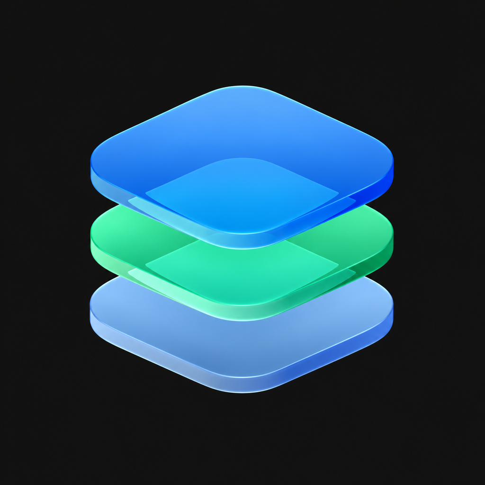

# Strata 4.0（简体中文构建）

[English](README.md) | **简体中文**

基于 [LiveContainer](https://github.com/LiveContainer/LiveContainer) 构建的可定制启动器，提供三种界面，并内置 SideStore 支持。

<p align="center"></p>

## 三种界面

- **iOS 主屏幕：** 竖屏布局，支持自定义图标与名称、静态/动态壁纸、小组件、文件夹、可拖动的翻页圆点、程序坞收藏、搜索，以及带分类的 App 资源库。
- **影院模式（Cinematic）：** 横屏主机风格的应用栏，支持封面图、分类、可调节的播放控件与手柄导航。
- **大屏模式（Big Picture）：** 横屏资源库，拥有独立的竖版封面图、分类、布局尺寸与手柄导航。

封面图、分类和隐藏 App 的设置在各界面之间相互独立。导入的封面图和壁纸保存在“文件” → 我的 iPhone → Strata → Artwork 中。

## 2.0 的新增内容

- 内置 JIT 准备流程：使用设备配对记录与 LocalDevVPN，并支持按 App 选择自动 / 通用 / 导入的脚本。
- 集成了运存扩展权限的账号配置，可查看真实的主机/访客内存报告。权限仍受 Apple 签名描述文件与 iOS 限制的约束。
- 启动器内部与访客进程中共用同一个三指应用切换器，可显示正在运行的 App 与可选固定项。无需常驻浮动箭头即可打开、恢复、最小化或关闭受支持的访客。
- 原生分页滚动、连续的程序坞/背景过渡动画，以及仅在主屏幕显示的翻页圆点（支持拖动）。
- 拖动可创建文件夹、将 App 拖出文件夹、解散文件夹时保留其中的 App，长按主屏幕空白处即可进入编辑。
- 对支持 Metal 的 App 可使用“带 Metal 性能监控启动”。

## 4.0 的新增内容（同步自上游）

本构建已整体并入上游 [huzaifahshahid71-ops/Strata](https://github.com/huzaifahshahid71-ops/Strata) 的 4.0：

- **六个界面**：除 iOS 主屏幕、影院模式、大屏模式外，新增切换台（Switchboard）、海报墙（Shelf）与街机（Arcade），均可用手柄导航。
- **运行环境管理**：访客文件浏览、便携备份（创建 / 校验 / 恢复）、签名身份与钥匙串迁移集中在一处。
- **自动续签**：按天数安排 SideStore 续签，到期提醒，并可配合「设置 VPN」快捷指令自动连接 LocalDevVPN。
- **帧生成（实验性）**：2×/3×/4× 显示帧与帧率测量面板。
- **存储索引**：重新扫描各访客容器并统计占用，可单独重算。
- **内存悬浮窗**：实时显示 Strata、各 App 与各辅助进程的占用与上限。
- **HostJIT 内联执行**：保留既有 iOS 启动、访客扩展 JIT 与多任务路径作为回退。

## 下载与安装

从 [Releases](https://github.com/huzaifahshahid71-ops/Strata/releases/tag/v2.0.0) 获取 **Strata-2.0+SideStore.ipa**，并使用 SideStore 签名安装。更新兼容的合并安装包时，请**保留当前 App 并选择“保留 App 扩展”**，并使用同一账号与标识以保留数据。操作前请先备份重要的访客数据。

Strata 2.0 是产品发布名称；此构建基于 LiveContainer **3.8.11** 与开发修订版 **25**。底层的包版本/标识保持不变，以兼容后续更新。IPA 中不包含个人签名凭据或配对记录。

## 汉化构建（v11 → v14）

`zh-hans` 分支提供完整简体中文界面与中文 README。v11 在回退后的 v7 基础上做了两件事：

**合并 LiveContainer 上游 2026-11-08 更新（`9d6ea09b05`）**：内置 JIT enabler / 运存 donor / 辅助进程与访客 App Extension 支持（`NSExtension+GuestHooks.m`、`LCPrepareGuestExtension`、`patchGuestExtensions`）、`LCAppModel.copy(fromApp:toAppInfo:)` 重构，以及 App 设置里新增的「启用应用辅助进程」开关。采用三方合并，Strata 的 LiveBoard 与游戏模式定制全部保留；上游 `copy` 里对 `fixBackgroundTaskIdentifiers` 的引用因 v7 不存在该属性已剔除。

**修复证书与模块导入**：

- 声明 `com.kdt.livecontainer.p12` UTI（`p12` / `pfx` / `pkcs12`）与 Signing Certificate 文档类型，可从「文件」App 直接用 Strata 打开证书，文件 URL 会路由到设置页。
- 证书导入支持安全作用域访问、空密码自动回退、`cert=` / `data=` 两种深链参数，成功后写入 `LCAppGroupID` 并给出提示。
- 模块导入用 `copyItem` + 安全作用域访问替代 `moveItem`，兼容从「文件」App / 分享入口进入的只读源。
- 新增 `strataPresentSafely`，绕开 SwiftUI `.alert` 关闭竞态，文档选择器与密码框不再静默失败；移除所有 `UTType` 强制解包。

包版本提升到 **3.8.19**，高于此前所有构建，可直接覆盖安装而无需卸载。此构建**不含 SideInstaller**；内置商店入口仍为原来的 SideStore。中文文案共 **1332 条**。

### v12：修复悬浮菜单「开关打开但没有微珠」

内置的 Orbit / LCFloatingMenu 升到上游 **1.0.36**（关闭按钮热区 +8pt），并修掉启动门控的根因：

- **不再要求 `guestAppInfo` 非空、也不再排除 `isLiveProcess`。** Strata 2.0 的多任务访客本身就跑在 `LiveProcess.appex` 里，旧判断会把所有访客排除，开关打开也毫无反应。
- 访客判定改为比较 `mainBundle` 是否已被改写成访客包；Strata 主界面与内置 SideStore 仍然不显示微珠。
- 开关依次从环境变量、App Group defaults、宿主 defaults 读取；三处都没写过时按「开启」处理并回写 App Group，避免开关写串 suite 后永远读不到。
- 启动尝试改为「立即 + 0.6s + 2s + 5s + 回到前台 / 场景激活」。开关在访客运行中打开也能生效，不用重启 App。
- 设置页「悬浮菜单」下方新增状态行与「复制诊断信息」，访客每次判定都会把结果写进 App Group，出问题时可直接定位卡在哪一步。
- 顺带清理：删除未使用的 `LCOrbitHost.isSupportedGuest`（其逻辑与 LiveProcess 访客冲突）、删除 `GuestInfo()` 与 `objc/message` 冗余引用，`installIfPossible` 与启动门控重复的宿主/访客/SideStore 判断合并为一处。

包版本提升到 **3.8.20**，中文文案共 **1337 条**。

### v13：修复右横屏错位 / 黑边，方向交还给系统

插件自带的「方向强制」层是根因，这次整层移除，只保留「保持屏幕常亮」：

- **不再改写 window 的 frame / bounds。** 原实现会在每次 `layoutSubviews` 和方向变化时把所有窗口硬设成 `(0,0,横屏宽,横屏高)`；iOS 13 之后窗口几何由 `UIWindowScene` 管理，硬改会让窗口与场景坐标系错位——右横屏时整块内容被推到一边、另一侧留黑边。
- **不再全局替换 `supportedInterfaceOrientations` / `__supportedInterfaceOrientations`。** 它和 LiveContainer 自己的每应用「方向锁」（`TweakLoader/UIKit+GuestHooks`）抢同一个方法，导致方向锁失效、只支持竖屏的 App 被强行旋转后布局错乱。
- **方向重新由系统与访客 App 自己声明**：支持横屏的 App 正常转，锁定竖屏的 App 保持竖屏，`App 设置 → 方向锁` 恢复生效。
- 悬浮菜单设置里的「左横屏自适应」「锁定禁右横屏」两个开关随之移除（它们只是给上面的强制层打补丁），「保持屏幕常亮」保留。

包版本提升到 **3.8.21**，中文文案共 **1337 条**。

### v14：补齐 LiveBoard / JIT / 运存页的残留英文

v13 之前只覆盖了「有明显的 `Text("...")` 字面量」这一层，`Text(三元表达式)`、`String` 变量、数组标签这些位置 **根本不会走本地化**，所以界面上仍残留大量英文。这次按显示路径逐类修掉：

- **三元表达式**（`Text(a ? "X" : "Y")`、`Label(...)`、`Button(...)`）：全部改为 `"X".loc`。SwiftUI 的 `Text`/`Label`/`Button` 遇到 `String` 参数不走本地化，这是 LiveBoard 三套界面（影院模式 / 大屏模式 / 主屏）里英文的主要来源。
- **`String` 赋值与返回值**：`LiveBoardMode.title/detail`、`StrataJITScriptMode.title`、`getStoreName()`、各处 `errorInfo = "..."`、`status = "..."`、`session.message = "..."`、`throw "..."` 统一走 `.loc`。
- **数组字面量标签**：控制台操作菜单（`["Launch", "App settings", …][index]`）逐项本地化。
- **带插值的提示**：改为 `LCStr("key", "fallback", args)` 固定 key，避免 Xcode 抽取键名漂移（新增 `strata.jit.guestAck` / `strata.memory.*` 等 9 个 key）。
- **ObjC 侧**：`StrataGuestControls` 的「App 控制不可用 / 隐藏 App 条 / 没有打开的 App」改用 `NSLocalizedString`。
- 带格式参数的三处文案（`"%lld apps"`、清理数据文件夹确认、移动文件夹完成）原用 `.localizeWithFormat()`，Xcode 抽取的键名与片段不一致导致回落英文，改为固定 key 的 `LCStr`。
- **分类标签**：LiveBoard 的默认分类（Games / Ports / Tools）作为数据仍保留英文键，显示层改走 `.loc`，并补上 `Ports`「移植」、`Tools`「工具」两条译文，避免分类条出现英文。
- 顺手清掉两条已无引用的旧键（`Other Entitlements`、`Version %@`），它们在代码里已找不到调用点。
- 中文文案 **1337 → 1452 条**（片段 1005 → 1120 项）。

包版本提升到 **3.8.23**。

### v16：把 SideStore 本体也翻成中文

`+SideStore` 包里的 SideStore 是官方 nightly 预编译包，被 `dylibify` 转成 `SideStoreApp.framework` 注入，它**自身不带任何 `.lproj`**——直接把英文原文当作本地化键（`NSLocalizedString("Pledge")`、`Text("Provisioning Profiles")`），再回落到 `Bundle.main`。注入后 `Bundle.main` 就是 LiveContainer，因此主 bundle 的 `zh-Hans` 表对它同样生效，不必改预编译二进制。

从 `LiveContainer/SideStore`（`LiveContainerSupport` 分支）源码扫出 1506 处界面文案，与已有中文表比对后补了 **828 条**，另生成 157 条 `%lld` 变体（SwiftUI 对整型插值生成的键是 `%lld` 而不是 `%@`）。覆盖：

- **账户与登录**：两步验证、Anisette 服务器、ADI 设备端模拟、退出登录确认
- **证书与描述文件**：创建/导入/吊销、私钥缺失、免费账户 1 张证书与 7 天有效期提示
- **设备与 App ID**：注册设备、UDID、App 组、能力开关
- **配对与隧道**：配对文件、LocalDevVPN、WireGuard 参数、EMProxy、Minimuxer
- **源与 App**：源校验（哈希 / 体积 / Bundle ID）、市场 App、更新与刷新、3 App 限额提示
- **日志与排查**：各子系统详细日志开关、原始转储、导出

键名保留英文、只翻译文，因此按原文取键的 `String(formatted:)` 一类调用不受影响。包版本升到 **3.8.24**，中文文案 **1452 → 2437 条**。

### v17：让 SideStore 的中文真正生效

v16 把 828 条 SideStore 文案写进了主 bundle 的 `zh-Hans`，但实机上仍是英文。原因在 `LCBootstrap.m`：

```objc
NSBundle *appBundle = [[NSBundle alloc] initWithPathForMainBundle:bundlePath];  // = Frameworks/SideStoreApp.framework
overwriteMainNSBundle(appBundle);   // 把 NSBundle.mainBundle 整个替换掉
```

SideStore 作为内置访客运行时，`Bundle.main` 被换成 `SideStoreApp.framework`，而这个 framework 里**一个 `.lproj` 都没有**，所以 `NSLocalizedString` 与 SwiftUI 的 `Text` 全部回落到英文原文，主 bundle 的中文表根本不会被查询。这一版做了两件事：

1. **打包时把中文表塞进 framework**：`build_github.sh` 在注入 `SideStoreApp.framework` 后，把主 bundle 的 `zh-Hans.lproj/Localizable.strings`（1452 条 Strata + 985 条 SideStore）复制到 framework 的 `zh-Hans.lproj` 和 `en.lproj`。后者是保险：任何语言解析路径都会落到中文，而不会退回英文。
2. **补齐烧死在 storyboard 里的静态文字**：设置页整屏、启动引导、标签栏的文字并不走本地化查询，而是编译进 nib（`Settings.storyboardc` / `Authentication.storyboardc` / `Main.storyboardc`）。新增 `LiveContainer/StrataGuestTextTranslation.m`，只在 `mainBundle` 路径包含 `SideStoreApp.framework` 时生效，给 `UILabel.setText:` / `UIButton.setTitle:forState:` / `UITabBarItem.setTitle:` / `UINavigationItem.setTitle:` / `UIViewController.setTitle:` / `UITextField.setPlaceholder:` / `UISearchBar.setPlaceholder:` 挂一层词表替换，覆盖设置页 40 余行、登录引导 20 余句、标签栏与「我的 App」页面。

宿主机进程与其他访客 App 不受影响（词表与挂钩都以 framework 路径为开关）。包版本升到 **3.8.25**。

### v18：把设置页那些写死在 storyboard 里的选项翻出来

v17 已经能查到 bundle 了，但截图里 "Background Refresh"、"Health Check"、"View Error Log"、"Storage Explorer" 这些行依旧是英文，而同屏的说明文字却是中文。两个原因：

1. **开关被 `dispatch_once` 锁死。** `LCGuestTextTranslationEnabled()` 用 `dispatch_once` 求值，而 `mainBundle` 是在 `main()` 之后才被换成 `SideStoreApp.framework` 的。第一次求值发生在替换之前（宿主自己的界面先跑），于是「不是访客」这个结论被永久缓存，词表钩子从此全部短路——这解释了为什么 v17 里一个字都没替换成功。
2. **nib 解码不走 setter。** `Settings.storyboard` 里 `text="Background Refresh"` 这类静态 label，编译成 nib 后由 `initWithCoder:` 直接恢复，`setText:` 钩子根本没被调用。说明文字能变中文，是因为它们由 `SettingsViewController` 用 `NSLocalizedString` 动态赋值。

这一版：

- 开关改成「只缓存 true，false 每次都重算」，不再有先手锁死的问题。
- 保留全部 setter 钩子，另加一条**视图树扫描**：`UIView.didMoveToWindow` 与 `UIViewController.viewWillAppear:` 触发时递归翻译 `UILabel`（含 `attributedText`）、`UIButton`（四种状态的 `title` 与 `attributedTitle`）、`UITextField` / `UISearchBar` 的 placeholder、`UISegmentedControl` 的分段标题，并顺带处理 `title` / `navigationItem.title` / `tabBarItem.title`。这样无论文字来自 nib 还是代码，都能落到词表。
- 词表补到 **106 条**，把 `Date` / `Email` / `Name` / `Type` / `Source Name` / `Developer` / `Installed` / `YES` / `NO` / `stable` 这类字段名也纳入。

包版本 **3.8.26**。


### v19：同步上游 Strata 4.0

按 `git merge` 把上游 `main`（`3221d76`，Release Strata 4.0）并入本分支，合并基线是共同祖先 v2.0.0：

- **保留本分支独有的两件事**：Orbit 多任务层（独立 `Orbit/`，未与上游冲突）与简体中文汉化。
- **解决 8 处冲突**：`LiveBoard` 新增的切换台 / 海报墙 / 街机三个界面补回 `.loc`；`LiveBoardHomeScreen` 采用上游重写的工具页；`StrataMemoryCapabilities` 采用上游的内存绕过提示并补 `.loc`；`LCAppModel` 恢复上游的 `fixBackgroundTaskIdentifiers`；`LCBootstrap` 保留上游的内存采样调用；`Info.plist` 版本定为 **4.0.0**。
- **CI 仍是本仓库的一套**：`runs-on: macos-latest` + Xcode 26.2（上游用的是自建 `xcode-27` 标签），并保留中文词条合并步骤。
- **新增 219 条中文词条**：工具页、运行环境、自动续签、帧生成、备份、身份与钥匙串、存储等 4.0 新界面全部补齐；`StrataToolsPage.Tool` 的标题是 `String`，必须显式 `.loc` 才会查表，已一并处理。
- 修掉一处上游在 Swift 6 下的编译问题：`Task.detached` 返回 `NSDictionary` 不是 `Sendable`，闭包被推断成 `Void`，改为在任务内转成 `[[String: String]]`。

包版本 **4.0.0**。


## JIT 与运存配置

在设备上导入你自己的配对记录，保留可用的 LocalDevVPN 配置，开启开发者模式，然后使用“JIT → 准备设备”。“带JIT启动”会复用现有的访客运行时与无头的 StikJIT 辅助程序。脚本兼容性因 App 而异：只有已验证的 ID 才会自动选用“通用”脚本；自定义导入与按 App 覆盖依然可用。

运存扩展权限配置会登录 Apple 的服务，为已安装的主机与访客 App ID 申请扩展内存权限。之后请使用已授权的签名描述文件重新安装/刷新。凭据仅在内存中处理，内存报告会区分访客的实际测量值与启动器的读取值。提出申请并不保证 iOS 会授予特定数量的内存。

## 限制与测试情况

- **LiveExec32 仍然需要 JIT。** 本版本中没有可用的免 JIT ARMv7 解释器/AOT 后端。
- **游戏模式由 iOS 控制。** “请求游戏模式”会声明访客支持并请求全屏启动；它无法在共享主机标识下为每个访客可靠地强制开启独立的系统游戏模式状态。
- Metal 性能监控需要受支持的 Metal 渲染路径。此最终构建的实机监控验证与 120 Hz 帧同步测量仍在等待完成。
- 普通的进程内访客无法在另一个主进程访客运行时保持独立挂起；切换时会复用现有的主机重启机制。独立的 JIT/多任务访客则保留各自的生命周期。
- 早期开发版本已在 iPhone 15 Pro 上测试：Angry Birds 可通过内置 JIT 运行，某个普通 JSAB 访客在启用内存权限后报告约 6 GiB 的总占用/余量。这些结果不代表所有访客都兼容。
- 发布构建与打包检查已通过。七项模拟器 UI 测试覆盖主屏幕手势、文件夹创建/拖出/删除、分类、壁纸，以及统一运行/固定切换器；针对文件夹模型的检查同样通过。手机上的最终流畅度、监控与进程切换检查仍需由用户实测。

## 从源码构建

```sh
git clone --recurse-submodules https://github.com/huzaifahshahid71-ops/Strata.git
cd Strata
python3 Scripts/fetch-bundled-dependencies.py
xcodebuild -project LiveContainer.xcodeproj -scheme LiveContainer \
  -configuration Release -sdk iphoneos -destination 'generic/platform=iOS' \
  CODE_SIGNING_ALLOWED=NO build
```

请使用带 iPhoneOS SDK 的 Xcode 26 或更新版本。目标名称仍为 LiveContainer。构建后步骤会嵌入 JIT 辅助程序与运行时。合并后的下载包保留了 SideStore 的原始组件；从源码全新构建的产物与该合并包并非逐字节一致。安装前请先为未签名构建签名。

## 致谢与许可

请参阅 [THIRD_PARTY_NOTICES.md](THIRD_PARTY_NOTICES.md)、保留的 [LiveContainer 许可证](LICENSE)、依赖声明以及固定版本的来源信息。StosSign 针对本 Strata 版本的再分发许可已由项目维护者于 2026 年 10 月 29 日确认；不对上游声明任何通用许可。Strata 与 Apple、Sony 或 Valve 均无关联。
